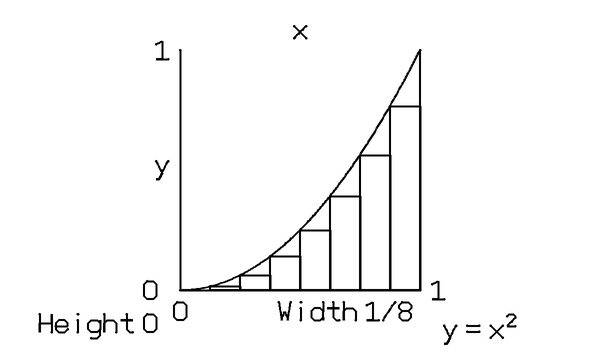
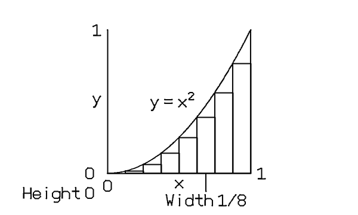
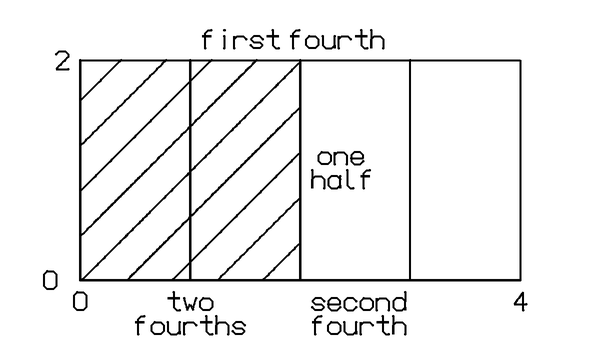
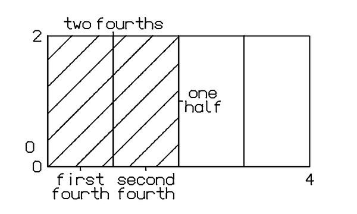

# Labels that belong to their pictures — 2026-10-29

This is a **renderer replay**, not a new model evaluation or a tablet test.
All nine previously complete lessons from the picture-v3/correction-v4 runs
still validate and encode as v6 ink. Their original story and shape bytes are
unchanged. No model calls, prompt edits, shortened labels or enlarged budgets.

## Before / after

| Saved answer | Before | After |
| --- | --- | --- |
| Astra integral, refinement panel |  |  |
| Luna fractions, final panel |  |  |

The integral's curve label now uses a location near the actual curve before
trying its bounding box. Axis titles stay on the requested edge of the frame.
External labels of rectangles/regions receive a straight unheaded pointer to
the middle of the facing edge. Interior labels need no pointer. The joint
placement search checks both text boxes and pointer geometry against other
labels/pointers and the final picture. Inherited panels retain identical ink.

These are improvements, not a teaching-quality pass. The fraction answer still
has unnecessary numeric axes, overlapping hatch patterns, and its `one half`
label is outside the shaded half (now connected to its boundary). The integral
still has a distracting `Height 0` label. The unchanged Pythagoras answer adds
extra triangle geometry and repeated letters. No model-authored content was
silently removed to make the comparison look better.

## Replay results

| Saved run / question | Before snapshot points | After snapshot points | Valid |
| --- | ---: | ---: | --- |
| luna-picture-v3 / blue-sky | 5153 | 5153 | yes |
| luna-picture-v3 / fractions | 10800 | 10820 | yes |
| luna-picture-v3 / water-cycle | 3739 | 3739 | yes |
| luna-picture-v3 / sensor-alarm | 3344 | 3344 | yes |
| astra-picture-v3 / integral | 6112 | 6132 | yes |
| luna-correction-v4 / fractions | 10788 | 10816 | yes |
| luna-correction-v4 / pythagoras | 5302 | 5326 | yes |
| luna-correction-v4 / inverse-mapping | 7983 | 7983 | yes |
| luna-correction-v4 / sensor-alarm | 4218 | 4218 | yes |

Five unaffected lessons have byte-identical stage PNGs. The four affected
lessons change only renderer-owned label/leader placement; source SHA256 pairs
match for all nine. `replay-summary.json` records those hashes. The `inputs/`
directory preserves the exact nine original story/shape pairs for reproduction.
Full before/final stage SVGs, PNGs and per-panel results remain at
`~/.buzz/OUTBOX/label-association-comparison-20261029/`.

Baseline: `b178517` draw code (clean `OUTBOX/cc-wFY4Vl`). Candidate:
`OUTBOX/la2-ul9j00`, the exact staged label changes excluding unrelated drafts.
Both already use diagonal region hatching; this does not compare against the
older vertical-hatching model-run previews.

## Verification and limits

- Clean candidate: **671 Python tests and 51 Node tests passed**, zero skips.
- Eleven added tests cover target attachment, crossings, reserved labels,
  inheritance, axis-edge ownership, curve-local candidates and real v6 encoding.
- A native-budget regression includes pointer strokes in the existing 64-stroke
  cap, separately from the primitive-command cap.
- Limits remain 64 strokes / 3,000 points / 30 seconds per stage and 12,000
  materialized snapshot points per story. Joint search remains bounded at 4,096
  attempts. Text is neither shrunk nor rewritten when placement fails.
- Tests' native log messages are mocks. No tablet deployment, native playback,
  handwriting-recognition or Respond-latency result is established here.

The full live goal remains unfinished. Next: remove the artificial contract
gap between a rectangle and a shaded rectangular region, then connect the
validated general story/panel output to the live notebook path and test it.
