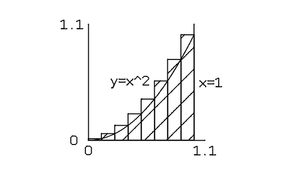
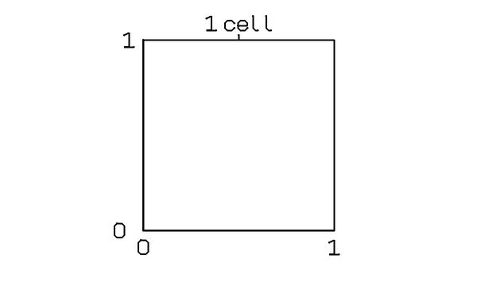

# One rectangular-fill capability — 2026-10-29

`rect` now accepts optional `fill: "none" | "hatch"`; omitted fill retains the
existing outline. `region` still requires an explicit fill. Both names use the
same measured bounds, outline, diagonal hatch generator, label attachments and
native budget accounting. This is a general drawing capability, not an answer
rewrite or a special case for a question.

Unknown fields, unsupported fill values (including null), out-of-frame geometry
and oversized plans still fail. Optional-field feedback distinguishes allowed
optional fields from missing required fields without echoing arbitrary values.
The isolated story/panel prompt states the same contract and the axis-label
edge constraint. No runtime prompt was installed and no model was changed.

## Saved failures replayed, not new complete answers

Source: `~/.buzz/OUTBOX/story-panel-eval-20261028/luna-correction-v4/`.
The original run stopped before later panels were generated. We replay only
its available panel prefix, selecting the last recorded response for each
panel (including the original correction where present). No missing panels
are fabricated, and no response item is edited. The complete original story
and raw panel responses are retained in `sources/`; `prefixes/` contains the
assembled prefix input and result. Original historical run results are intact.

| Recorded question | Available / planned panels | Replay result |
| --- | ---: | --- |
| Integral | 2 / 4 | Encodes successfully, 3,004 snapshot points |
| Odd squares | 1 / 4 | Encodes successfully, 938 snapshot points |
| Bayes | 2 / 4 | Still fails: label placement search budget exceeded |

These are **two recovered prefixes, zero newly completed lessons**. No model
calls, no Respond timing, no tablet writes. Bayes now passes the fill contract
but its layout failure remains a failure under the same search limit.

The integral preview visibly contains the requested shaded rectangles.
Its literal `y=x^2` label is not equation typesetting; that remains a separate
renderer capability gap. The extra 1.1 frame labels come from the model's chosen
data bounds, not the compiler changing its mathematical values.

The odd-squares prefix is just its first cell, not the intended full explanation.

## Tests and scope

Clean staged export `OUTBOX/rf-JzqSDP`: **677 Python and 51 Node tests passed**,
zero skips. New tests compare the two spellings' full plans, labels, inherited
ink, measured bounds and encoded native costs; verify outline compatibility;
reject unsupported fill; retain resource limits; and check prompt/contract
agreement. The earlier nine accepted-answer replay inputs all remain valid.

The OpenAI Docs skill was used for the prompt-contract change. The
[structured-output guidance](https://developers.openai.com/api/docs/guides/structured-outputs)
distinguishes schema conformance from merely valid JSON. This implementation
uses local validation; it does **not** claim API-level constrained decoding.
An optional field in this local DSL is not an API Structured Outputs schema.

This removes one artificial grammar failure. It does not establish polished
lesson quality or live story/panel delivery. Device code and guards are unchanged.
