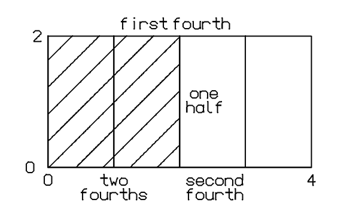
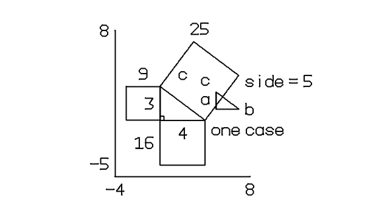
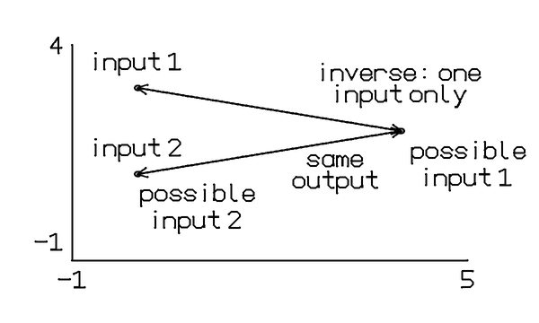
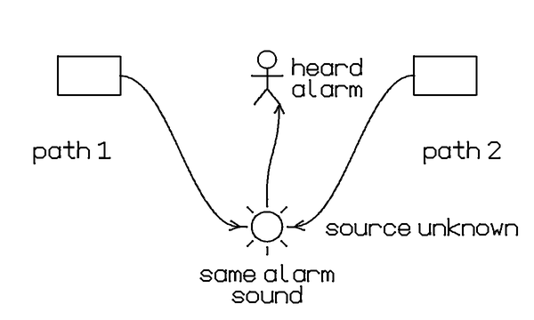

# Bounded correction experiment — 2026-10-29

**Outcome: 4/14 complete compiler/encoder passes; no lesson recovered by
correction. Not ready for live rollout.** These are generated explanations,
not authored scenes, but compilation is not a teaching-quality pass.

The frozen run used Luna on PiDog's isolated `story-panel-v1` socket, minimal
reasoning, 2,400 requested output tokens and a 30-second per-call deadline.
The same fourteen typeset questions and image bytes were retained. This tests
generation, not handwriting recognition. One optional correction was allowed
per entire lesson; the production/default policy remains zero.

- Code: `6749291`; clean executable export `OUTBOX/cc-wFY4Vl`.
- Tests: 660 Python and 51 Node passed; native log messages were mocks.
- Packet SHA256: `a723ebf1d181ac5a88c373f6cd6fb9f656aeac4964ff4f5d664b850dc6ece231`.
- Prompt SHA256: `0fce781e370c1df77fb57199109b7416939a76f28363d7cba7392a16ada06372`.
- Full requests, raw answers, timings and stage previews:
  `OUTBOX/story-panel-eval-20261028/luna-correction-v4/`.
- 54 call attempts, 53 completed model envelopes. The last question timed out;
  all fourteen were attempted, none silently omitted. The provider was then
  independently confirmed idle using an invalid request that invokes no model.
- Three correction calls added 10.878 seconds combined and recovered zero
  complete lessons. The four accepted lessons all passed without correction.
- Sum of per-question pipeline times: 271.003 seconds. These are offline
  pipeline times, **not Respond-to-first-visible-response measurements**.

| Question | Final result | Correction calls | Pipeline seconds |
| --- | --- | ---: | ---: |
| Integral | Rectangles carried unsupported `fill` fields after JSON correction | 1 | 19.655 |
| Gravity | Label exceeds text limit | 0 | 12.819 |
| Odd squares | Rectangle carries unsupported `fill` field | 1 | 12.623 |
| Compound interest | Label search budget exhausted | 0 | 20.280 |
| Transistor | No joint clear label placement | 0 | 25.705 |
| Blue sky | Unsupported lambda label glyph | 0 | 12.840 |
| Bayes | Rectangles carry unsupported `fill` fields | 1 | 18.108 |
| Fractions | Compiler/encoder pass; visual issues below | 0 | 15.816 |
| Water cycle | No clear connector route | 0 | 22.665 |
| Pythagoras | Compiler/encoder pass; visual issues below | 0 | 28.186 |
| Inverse mapping | Compiler/encoder pass; visual issues below | 0 | 19.135 |
| Sensor/alarm | Compiler/encoder pass; visual issues below | 0 | 20.751 |
| Proof dependency | Explicitly declined a contradictory inherited step | 0 | 12.404 |
| Dependency failure | Story provider deadline | 0 | 30.016 |

## Visual review

All fifteen stage PNGs and their captions/takeaways were inspected. Final
images below are copied unchanged from that frozen run. No diagram was fixed
by hand and no missing stage was filled in.

### Fractions

The half-area and partitioning convey the intended equivalence; diagonal
hatching is clearly different from partition lines. However, `one half`
appears in the unshaded half, and the two fourth labels drift away from their
targets. Non-overlap alone does not preserve obvious label ownership. Later
stages also overlay identical hatch strokes instead of referring to existing
shading. Axes are unnecessary for this area model.

### Pythagoras

The three squares and 9 + 16 = 25 relationship are visible, and the caption
correctly distinguishes an example from a general proof. The last panel adds
a second triangle and extra letters inside the picture, making it harder to
read. Repeated `c` and detached `side = 5` show that legal geometry and text
do not ensure a clean explanation. The squares already appear before their
individual explanation beats.

### Inverse mapping

Two inputs converge on one output, then reverse arrows show ambiguity. The
picture communicates the main idea, but its final `inverse: one input only`
label reads like a claim about this non-invertible function rather than a
requirement for an inverse. Captions supply the qualification. Numeric axes
and repeated labels add clutter without helping the argument.

### Sensor/alarm

The two paths converge on one alarm and the caption states that either can
trigger it. An observer is added last. The structure is understandable, but
the sensors remain unlabeled boxes and the alarm uses a sun icon. This is a
schematic prototype, not a polished doodle demonstration.

## Decisions from this evidence

1. Do not enable correction by default or expand its retry budget. In this
   run it added latency without recovering a complete lesson. This is not a
   controlled claim that the prompt caused a regression: the older prompt
   and generated answers differ.
2. Improve label ownership, not just collision avoidance: keep labels near
   the target or use a clearly associated, collision-checked leader line.
   Any leader must consume the existing native stroke/point/time budget.
3. Simplify the public drawing contract where distinctions are artificial.
   All three corrected failures used rectangle fill. A future explicit
   shaded-rectangle capability must actually render the requested shading,
   not silently discard an unknown field. Do not rewrite these trial answers.
4. Add mathematical glyph support deliberately; never substitute a replacement
   box or relabel a symbol into a different meaning.
5. Preserve semantic reuse and teaching order. Geometric validity cannot
   detect redundant hatch strokes or an explanation that reveals its conclusion
   too early; the whole-lesson visual review remains necessary.

A read-only layout experiment removed duplicate candidate boxes and added
forward checking to the compound-interest failure. It still exceeded the
unchanged 4,096-attempt search limit. No solver change or budget increase was
shipped from that unsuccessful experiment.

No tablet writes, native adapter changes or production prompt/model changes
were made. Multi-picture native delivery, handwritten-input reliability,
visible latency, persistence and broader notebook rollout remain unproven
for this story/panel pipeline.
